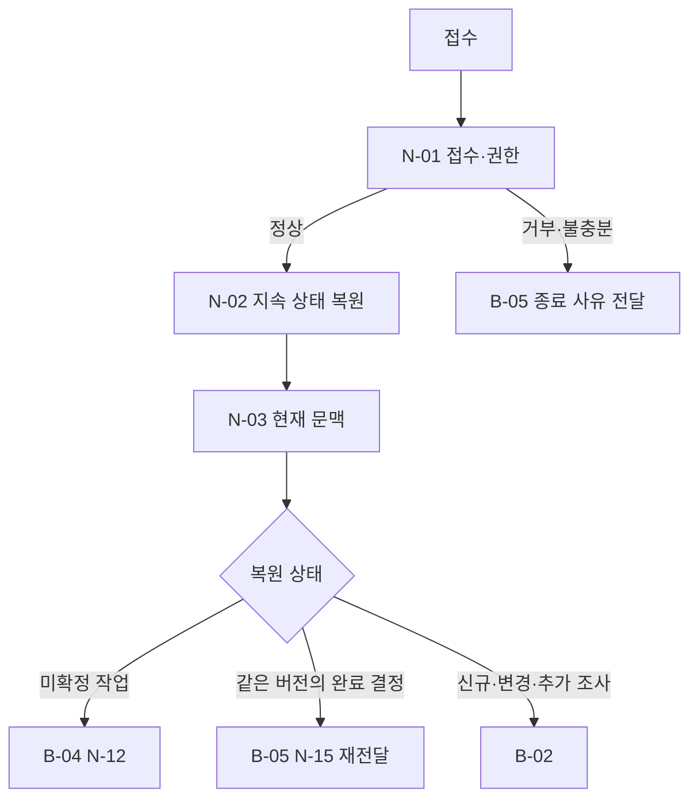

# B-01 · Case Intake and Restore — 접수·현재 권한·지속 상태 복원

> **설계 초안 v0.1 / 미구현**. [Big Node 목록](README.md) · [전체 구조](../overall-plan/architecture.md) · [공통 계약](../contracts/README.md)

## 1. 목적·입출력

원본 접수와 현재 권한을 확인하고 이전 실행의 미확정 의도·예산·출처를 복원한다.

- 입력: 원본 request_ref, case_id, 인증된 TrustedCallContext, 선택적 logical_run_id.
- 출력: CaseContext와 RestoredRun. 이전 결정 또는 pending operation의 참조.
- 이 Big Node는 LLM 한 번이나 단일 Tool을 뜻하지 않는다. 업무·평가 코드가 Small Node를 정해진 순서·분기로 실행한다.

## 2. 사용 Small Node

| 상세 계약 | 함수 | 단일 책임 |
|---|---|---|
| [N-01](../small-nodes/N-01.md) | `admit_case` | 접수·권한·지원 범위 확인 |
| [N-02](../small-nodes/N-02.md) | `restore_run` | 체크포인트·미확정 의도 복원 |
| [N-03](../small-nodes/N-03.md) | `build_case_context` | 현재 조사 문맥 구성 |

개별 함수·data 필드·오류·최소 검사 사례는 위 Small Node가 정본이다. 여기서는 연결·반복·종료 정책을 관리한다.

## 3. 실행 그래프

마름모는 조건부 Edge이며 추가 Small Node가 아니다. 실제 함수의 status/outcome과 현재 예산을 코드로 해석한다. 모델이 새 엣지를 추가할 수는 없다.

## 4. 조건부 분기·대기·종료

| 조건 | 동작 |
|---|---|
| 권한·입력 불충분 | N-01 결과를 B-05/N-15로 전달. 다른 case를 임의 선택하지 않음 |
| 상태 저장소 손상 | 실행 오류. fresh로 시작하여 새 쓰기를 발행하지 않음 |
| pending operation | N-03으로 현재 scope를 구성한 뒤 B-04/N-12에서 효과 조회 |
| durable 결정 + 같은 입력 | 현재 읽기 권한을 확인하고 N-15에서 같은 as-of 결과 재전달 |
| durable 결정 + 입력 변경 | 과거 결정 보존, parent_run_id로 연결한 새 logical_run을 B-02로 연결. 같은 trial의 총 예산은 공유 |

## 5. 상태·권한·예산

과거 scope·요약을 현재 권한으로 승격하지 않는다. 예산·operation ID를 재개 때 초기화하지 않는다.

노드 결과와 의도·관측·누적 예산을 [지속 상태 계약](../contracts/persistence-and-recovery.md)에 따라 보존한다. 권한·저장 오류는 안전한 성공 경로로 숨기지 않는다. 조회·시도·보정·재개도 전체 예산에 포함한다. 상한은 [설계 결정](../overall-plan/decisions.md)의 제안값을 파일럿 후 고정한다.

## 6. 검증할 연결 사례

| 사례 | 확인 결과 |
|---|---|
| 다른 case 접근 | 업무 데이터 반환 없이 거부 |
| 응답 미저장 후 재개 | 기존 operation 참조 유지 |
| 완료 후 출력 실패 | 같은 결정 전달·새 효과 0 |

노드별 계약 검사와 별도로 이 Big Node의 연결 경로를 확인한다. 최종 평가는 [평가 계획](../evaluation/README.md)에서 실제 결과·금지 효과·비용으로 판정한다.
