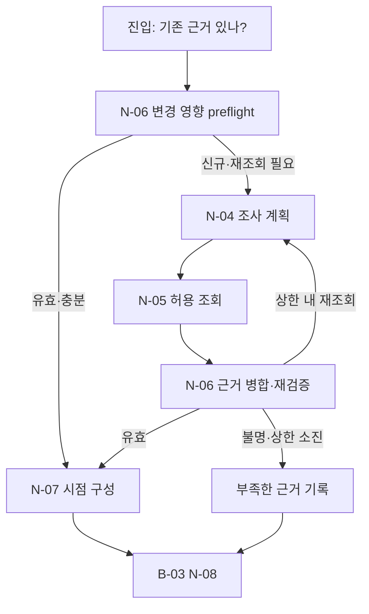

# B-02 · Evidence Investigation — 허용 조사·선택적 재검증·시점별 근거

> **설계 초안 v0.1 / 미구현**. [Big Node 목록](README.md) · [전체 구조](../overall-plan/architecture.md) · [공통 계약](../contracts/README.md)

## 1. 목적·입출력

조회 조건과 입력 변경의 영향을 연결하여 필요한 증거를 수집하고 판단 시점에 맞는 근거를 만든다.

- 입력: CaseContext, 이전 evidence/dependency refs, 현재 input_version, 누적 조사 예산.
- 출력: AsOfEvidence, RevalidationReport, 안전한 부분 관측·부족한 항목.
- 이 Big Node는 LLM 한 번이나 단일 Tool을 뜻하지 않는다. 업무·평가 코드가 Small Node를 정해진 순서·분기로 실행한다.

## 2. 사용 Small Node

| 상세 계약 | 함수 | 단일 책임 |
|---|---|---|
| [N-04](../small-nodes/N-04.md) | `plan_investigation` | 제한된 조사 계획 제안 |
| [N-05](../small-nodes/N-05.md) | `collect_evidence` | 허용 조회 실행·증거 등록 |
| [N-06](../small-nodes/N-06.md) | `revalidate_dependencies` | 변경 영향·부정 증거 재검증 |
| [N-07](../small-nodes/N-07.md) | `assemble_asof_evidence` | 판단 시점의 근거 구성 |

개별 함수·data 필드·오류·최소 검사 사례는 위 Small Node가 정본이다. 여기서는 연결·반복·종료 정책을 관리한다.

## 3. 실행 그래프

마름모는 조건부 Edge이며 추가 Small Node가 아니다. 실제 함수의 status/outcome과 현재 예산을 코드로 해석한다. 모델이 새 엣지를 추가할 수는 없다.

## 4. 조건부 분기·대기·종료

| 조건 | 동작 |
|---|---|
| 이전 근거 없음 | 빈 근거 집합에서 재조회 필요를 반환. preflight는 추가 모델 호출 아님 |
| 변경 영향 없음 | 필수 근거가 완전하면 N-04/05를 생략하고 N-07 |
| 관련 삽입·수정·삭제 | 그 predicate의 근거를 무효화하고 해당 조회만 실행 |
| mutation 누락·범위 증명 불가 | 관련 배치 전체를 보수적으로 재조회 |
| 미래·혼합 버전·불완전 관측 | 완료 근거에 포함하지 않고 부족한 사실을 B-03으로 전달 |
| 조사 상한 도달 | 무한 재검색 없이 미확정 근거를 보존 |

## 5. 상태·권한·예산

실제 실행 순서의 정본은 이 문서다. fresh 경로는 N-04→05→06→07, 이전 근거가 있으면 N-06 preflight로 시작한다. query 0건과 데이터의 영구 부재를 구분한다.

노드 결과와 의도·관측·누적 예산을 [지속 상태 계약](../contracts/persistence-and-recovery.md)에 따라 보존한다. 권한·저장 오류는 안전한 성공 경로로 숨기지 않는다. 조회·시도·보정·재개도 전체 예산에 포함한다. 상한은 [설계 결정](../overall-plan/decisions.md)의 제안값을 파일럿 후 고정한다.

## 6. 검증할 연결 사례

| 사례 | 확인 결과 |
|---|---|
| 빈 조회 뒤 관련 삽입 | 누락 없이 재조회 |
| 다른 batch 변경 | 비중첩 증명 후 KEEP |
| 10:05 자료·10:00 판단 | 미래 미노출 |
| 상세 페이지만 일부 | 전체 일치를 선언하지 않음 |

노드별 계약 검사와 별도로 이 Big Node의 연결 경로를 확인한다. 최종 평가는 [평가 계획](../evaluation/README.md)에서 실제 결과·금지 효과·비용으로 판정한다.
