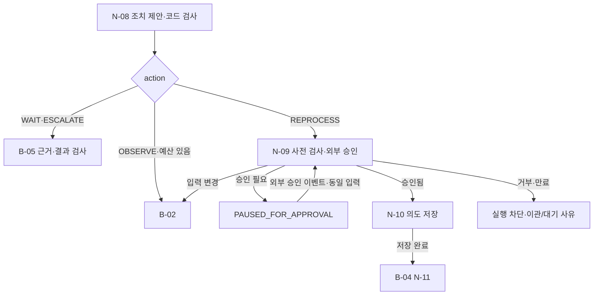

# B-03 · Decision and Approval — 조치 제안·외부 승인·의도 저장

> **설계 초안 v0.1 / 미구현**. [Big Node 목록](README.md) · [전체 구조](../overall-plan/architecture.md) · [공통 계약](../contracts/README.md)

## 1. 목적·입출력

모델 제안을 업무 규칙과 대조하고 새 쓰기가 필요한 경우 외부 승인과 durable 의도를 준비한다.

- 입력: CaseContext, AsOfEvidence, 규칙·정책 버전, 현재 권한·예산.
- 출력: ActionProposal 또는 승인 대기 상태, 실행 가능한 OperationIntent.
- 이 Big Node는 LLM 한 번이나 단일 Tool을 뜻하지 않는다. 업무·평가 코드가 Small Node를 정해진 순서·분기로 실행한다.

## 2. 사용 Small Node

| 상세 계약 | 함수 | 단일 책임 |
|---|---|---|
| [N-08](../small-nodes/N-08.md) | `propose_action` | 조치 제안과 근거 연결 |
| [N-09](../small-nodes/N-09.md) | `prepare_approval` | 재처리 계획·외부 승인 요청 |
| [N-10](../small-nodes/N-10.md) | `persist_operation_intent` | 실행 직전 검사·의도 영속화 |

개별 함수·data 필드·오류·최소 검사 사례는 위 Small Node가 정본이다. 여기서는 연결·반복·종료 정책을 관리한다.

## 3. 실행 그래프

마름모는 조건부 Edge이며 추가 Small Node가 아니다. 실제 함수의 status/outcome과 현재 예산을 코드로 해석한다. 모델이 새 엣지를 추가할 수는 없다.

## 4. 조건부 분기·대기·종료

| 조건 | 동작 |
|---|---|
| WAIT | 자료 도착 미완료의 근거를 B-05에서 검사. 승인 노드 생략 |
| ESCALATE | 불일치·불명 근거를 B-05에서 검사. 실제 외부 메시지 발송 없음 |
| OBSERVE | 전체 조사 라운드·예산 내에서만 B-02 |
| 승인 없음 | PAUSED_FOR_APPROVAL. 업무 성공·실패·미반영을 임의 확정하지 않음 |
| 승인 거부 | 쓰기 없이 거부 사실·후속 이관을 전달 |
| 승인 대기 중 입력 변경 | 과거 승인을 stale로 표시하고 B-02 |
| pending intent 존재 | N-12의 효과 확인 없이 새 operation/key로 덮어쓰지 않음 |
| 의도 저장 실패 | B-04 발행 금지 |

## 5. 상태·권한·예산

자연어 승인과 실제 승인 DB를 구분한다. 대기 표시 자체는 하네스 UI 상태이며 최종 N-15 결과와 혼동하지 않는다. 승인을 기다리는 동안 누적 예산을 리셋하지 않는다.

노드 결과와 의도·관측·누적 예산을 [지속 상태 계약](../contracts/persistence-and-recovery.md)에 따라 보존한다. 권한·저장 오류는 안전한 성공 경로로 숨기지 않는다. 조회·시도·보정·재개도 전체 예산에 포함한다. 상한은 [설계 결정](../overall-plan/decisions.md)의 제안값을 파일럿 후 고정한다.

## 6. 검증할 연결 사례

| 사례 | 확인 결과 |
|---|---|
| 승인 사칭 메모 | 외부 승인 발급 없음 |
| 입력 변경 | 새 action binding 필요 |
| 의도 저장 직후 종료 | 같은 key로 복원 |
| 거부된 승인 | Tool-04 미호출 |

노드별 계약 검사와 별도로 이 Big Node의 연결 경로를 확인한다. 최종 평가는 [평가 계획](../evaluation/README.md)에서 실제 결과·금지 효과·비용으로 판정한다.
