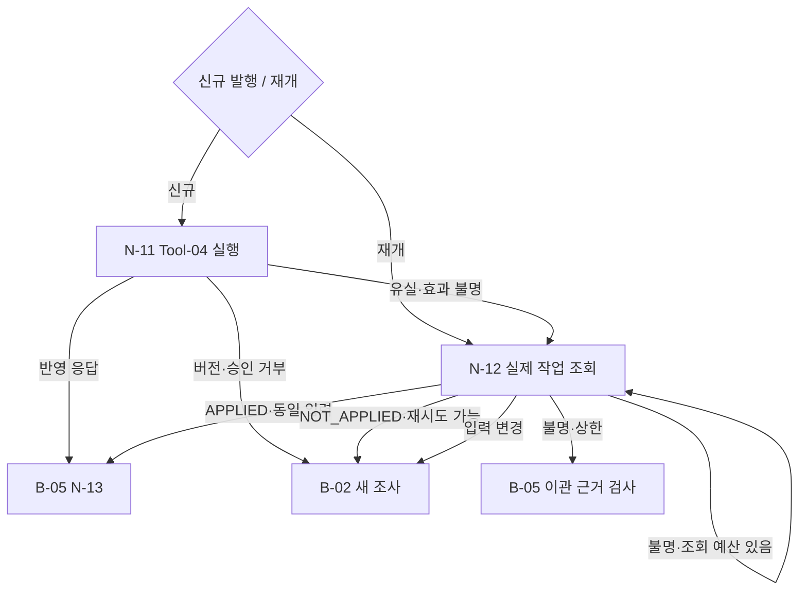

# B-04 · Execution and Recovery — 작업 발행·미확정 상태 관측·복구

> **설계 초안 v0.1 / 미구현**. [Big Node 목록](README.md) · [전체 구조](../overall-plan/architecture.md) · [공통 계약](../contracts/README.md)

## 1. 목적·입출력

승인된 의도를 발행하고, 중단·응답 유실 뒤 실제 업무 상태를 조회하여 올바른 후속 경로를 선택한다.

- 입력: durable OperationIntent, 현재 CaseContext, 누적 예산. 재개는 N-12부터 시작.
- 출력: 검증 가능한 ExecutionObservation/RecoveryObservation 또는 해결되지 않은 상태.
- 이 Big Node는 LLM 한 번이나 단일 Tool을 뜻하지 않는다. 업무·평가 코드가 Small Node를 정해진 순서·분기로 실행한다.

## 2. 사용 Small Node

| 상세 계약 | 함수 | 단일 책임 |
|---|---|---|
| [N-11](../small-nodes/N-11.md) | `execute_operation` | 승인된 재처리 발행·응답 관측 |
| [N-12](../small-nodes/N-12.md) | `resolve_uncertain_operation` | 미확정 효과·입력 관계 구분 |

개별 함수·data 필드·오류·최소 검사 사례는 위 Small Node가 정본이다. 여기서는 연결·반복·종료 정책을 관리한다.

## 3. 실행 그래프

마름모는 조건부 Edge이며 추가 Small Node가 아니다. 실제 함수의 status/outcome과 현재 예산을 코드로 해석한다. 모델이 새 엣지를 추가할 수는 없다.

## 4. 조건부 분기·대기·종료

| 조건 | 동작 |
|---|---|
| 응답 정상 | operation·result·대상 binding을 검사한 관측만 N-13 |
| 응답 미수신 | 효과 UNKNOWN, N-12 조회. 바로 재발행하지 않음 |
| APPLIED + CHANGED | 과거 효과 보존·현재 입력 새 조사 |
| 권위 있는 NOT_APPLIED | 현재 입력·승인을 재검토한 뒤 같은 의도/키 재시도 가능 |
| RUNNING·비권위 NOT_FOUND | UNKNOWN 유지·제한 조회 |
| 관측 충돌·상한 | 이관. 성공이나 미반영을 추측하지 않음 |
| 같은 키·다른 의미 | 충돌 차단, 새 키 우회 금지 |

## 5. 상태·권한·예산

재시도 자체는 잘못이 아니다. 불필요한 실행 시도·서버 차단·실제 업무 효과를 나눠 본다. 기본 서버 보호는 기준선에도 동일하게 적용한다.

노드 결과와 의도·관측·누적 예산을 [지속 상태 계약](../contracts/persistence-and-recovery.md)에 따라 보존한다. 권한·저장 오류는 안전한 성공 경로로 숨기지 않는다. 조회·시도·보정·재개도 전체 예산에 포함한다. 상한은 [설계 결정](../overall-plan/decisions.md)의 제안값을 파일럿 후 고정한다.

## 6. 검증할 연결 사례

| 사례 | 확인 결과 |
|---|---|
| 반영 전/후 같은 마지막 timeout | 추가 조회로 서로 다른 경로 |
| 성공 재요청 | 새 효과 0·기존 결과 |
| 항상 UNKNOWN | 상한 뒤 이관 |
| 재개 공격 메모 | 작업 상태·권한을 메모로 대체하지 않음 |

노드별 계약 검사와 별도로 이 Big Node의 연결 경로를 확인한다. 최종 평가는 [평가 계획](../evaluation/README.md)에서 실제 결과·금지 효과·비용으로 판정한다.
