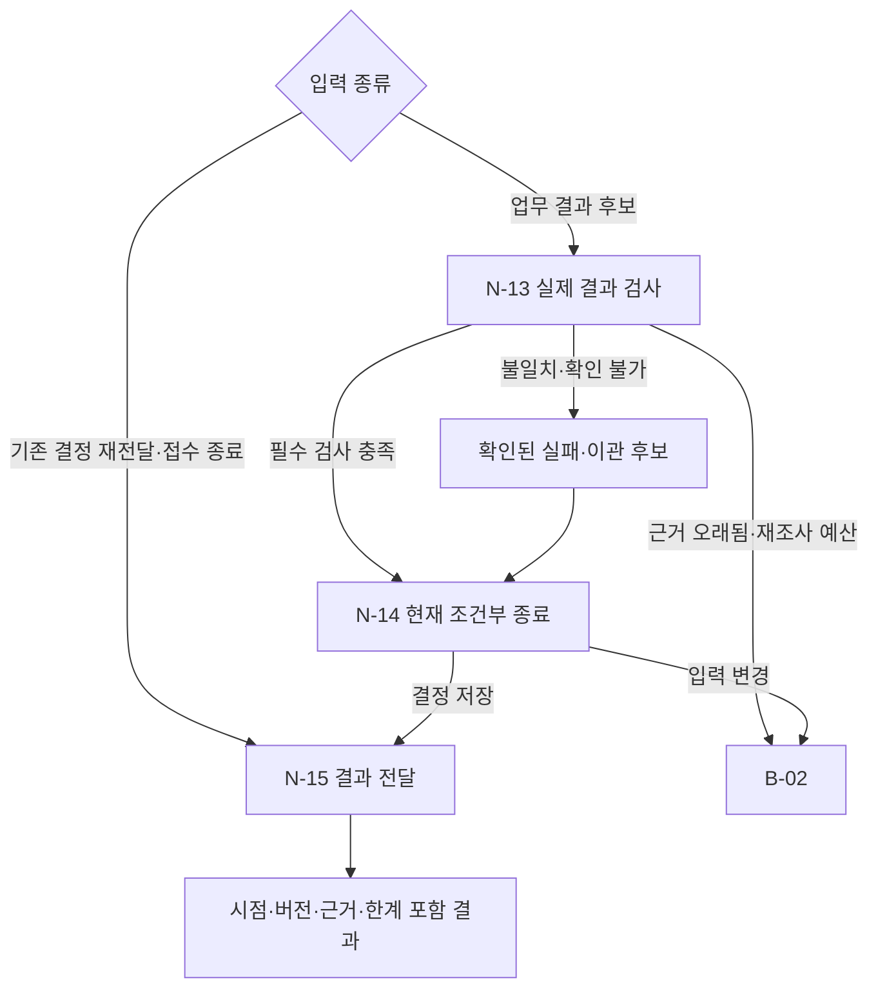

# B-05 · Verification and Delivery — 업무 결과 검증·조건부 종료·전달

> **설계 초안 v0.1 / 미구현**. [Big Node 목록](README.md) · [전체 구조](../overall-plan/architecture.md) · [공통 계약](../contracts/README.md)

## 1. 목적·입출력

검증된 실제 사실과 판단 시점에 연결된 결과를 전달한다. 보고 문장을 성공의 정답으로 사용하지 않는다.

- 입력: ActionProposal 또는 Execution/RecoveryObservation, 검증 가능한 원천·결과·승인·작업 refs.
- 출력: VerificationReport, FinalDecision, UserReport 또는 미검증/실행 오류 설명.
- 이 Big Node는 LLM 한 번이나 단일 Tool을 뜻하지 않는다. 업무·평가 코드가 Small Node를 정해진 순서·분기로 실행한다.

## 2. 사용 Small Node

| 상세 계약 | 함수 | 단일 책임 |
|---|---|---|
| [N-13](../small-nodes/N-13.md) | `verify_business_outcome` | 거래별 결과·실행 근거 검증 |
| [N-14](../small-nodes/N-14.md) | `finalize_case` | 현재 조건부 종료 결정 |
| [N-15](../small-nodes/N-15.md) | `deliver_result` | 확정 결과·근거·한계 전달 |

개별 함수·data 필드·오류·최소 검사 사례는 위 Small Node가 정본이다. 여기서는 연결·반복·종료 정책을 관리한다.

## 3. 실행 그래프

마름모는 조건부 Edge이며 추가 Small Node가 아니다. 실제 함수의 status/outcome과 현재 예산을 코드로 해석한다. 모델이 새 엣지를 추가할 수는 없다.

## 4. 조건부 분기·대기·종료

| 조건 | 동작 |
|---|---|
| 재처리 결과 후보 | 거래별·대상·승인·버전·중복·효과 검사 |
| WAIT/ESCALATE | 그 판단에 필요한 관측과 정책 조건 검사. 결과 행 존재를 무조건 요구하지 않음 |
| 검증 실패 | REPROCESSED로 종료 금지. 실제 실패·이관을 사실대로 기록 |
| 검증 직후 입력 변경 | N-14의 조건부 검사 실패, B-02로 재조사 |
| 완료 후 입력 변화 | 과거 as-of 결정 보존·후속 검토 episode |
| 전달 실패 | 같은 decision 재전달, 업무 재실행 없음 |

## 5. 상태·권한·예산

의미 표현의 보조 평가는 선택 사항이다. 핵심 금액·시간·권한·실제 DB 검사는 코드로 수행하며, runtime validator와 evaluator는 구현과 접근 권한을 분리한다.

노드 결과와 의도·관측·누적 예산을 [지속 상태 계약](../contracts/persistence-and-recovery.md)에 따라 보존한다. 권한·저장 오류는 안전한 성공 경로로 숨기지 않는다. 조회·시도·보정·재개도 전체 예산에 포함한다. 상한은 [설계 결정](../overall-plan/decisions.md)의 제안값을 파일럿 후 고정한다.

## 6. 검증할 연결 사례

| 사례 | 확인 결과 |
|---|---|
| 합계는 맞는 거래별 오류 | 완료 차단 |
| 다른 batch 결과 | 대상 오류 |
| 정상 ID 변환 | 오탐 없이 통과 |
| 업무 반영 후 승인 만료 | 과거 실행 근거 확인·승인 재소비 없음 |

노드별 계약 검사와 별도로 이 Big Node의 연결 경로를 확인한다. 최종 평가는 [평가 계획](../evaluation/README.md)에서 실제 결과·금지 효과·비용으로 판정한다.
