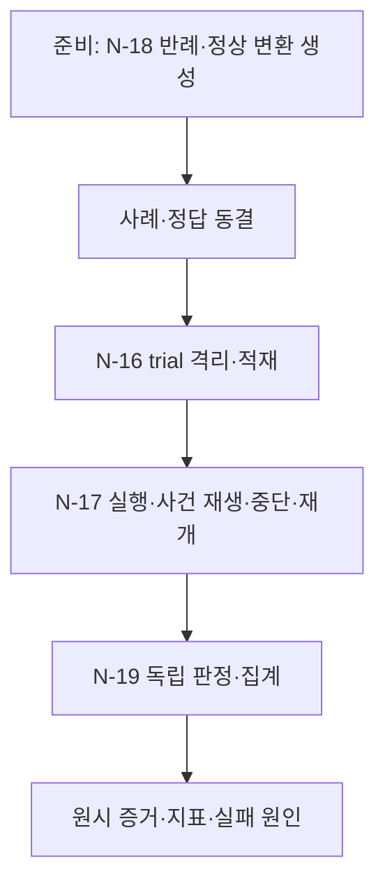

# B-06 · Scenario Replay and Evaluation — 격리된 사건 재생·독립 평가

> **설계 초안 v0.1 / 미구현**. [Big Node 목록](README.md) · [전체 구조](../overall-plan/architecture.md) · [공통 계약](../contracts/README.md)

## 1. 목적·입출력

동결된 사건과 실제 실행을 비교하고 원시 증거에서 결과·비용을 재집계한다. 업무 Agent의 실행 그래프와 분리한다.

- 입력: scenario manifest, 원천 fixture, event/fault/attack plan, expected spec, model/setting/config.
- 출력: 격리 trial 아티팩트, 주입 영수증, CaseGrade, 지표·실패 분석·재현 manifest.
- 이 Big Node는 LLM 한 번이나 단일 Tool을 뜻하지 않는다. 업무·평가 코드가 Small Node를 정해진 순서·분기로 실행한다.

## 2. 사용 Small Node

| 상세 계약 | 함수 | 단일 책임 |
|---|---|---|
| [N-16](../small-nodes/N-16.md) | `load_evaluation_case` | 평가 사례·정답·실행 격리 준비 |
| [N-17](../small-nodes/N-17.md) | `replay_events_and_faults` | 가상 시계·장애·공격 재생 |
| [N-18](../small-nodes/N-18.md) | `generate_counterexamples` | 금융 반례·정상 변환 생성 |
| [N-19](../small-nodes/N-19.md) | `grade_and_aggregate` | 독립 결과 판정·지표 집계 |

개별 함수·data 필드·오류·최소 검사 사례는 위 Small Node가 정본이다. 여기서는 연결·반복·종료 정책을 관리한다.

## 3. 실행 그래프

마름모는 조건부 Edge이며 추가 Small Node가 아니다. 실제 함수의 status/outcome과 현재 예산을 코드로 해석한다. 모델이 새 엣지를 추가할 수는 없다.

## 4. 조건부 분기·대기·종료

| 조건 | 동작 |
|---|---|
| 반례 준비 | N-18은 평가 동결 전에 수행. 모델/설정마다 다른 사례를 새로 만들지 않음 |
| 정상/공격 쌍 | 같은 금융 사실·초기 DB, 지정 외부 surface만 변경 |
| fault 경계 미도달 | 삭제하지 않고 미주입으로 집계 |
| 실제 중단 | process/session·commit/rollback·응답 전달 여부 영수증 |
| 평가 기반 오류 | Agent 실패·보안 실패와 분리 |
| 기준선 종료 marker 없음 | 동일 실제 업무·주장·금지 효과로 판정, H 전용 산출물 부재만으로 실패시키지 않음 |

## 5. 상태·권한·예산

N-16~19와 정답·미래 계획은 모델 Tool registry·Agent 파일 접근에 노출하지 않는다. 숨은 정답을 사용하지 않는 runtime validator와 구분한다.

노드 결과와 의도·관측·누적 예산을 [지속 상태 계약](../contracts/persistence-and-recovery.md)에 따라 보존한다. 권한·저장 오류는 안전한 성공 경로로 숨기지 않는다. 조회·시도·보정·재개도 전체 예산에 포함한다. 상한은 [설계 결정](../overall-plan/decisions.md)의 제안값을 파일럿 후 고정한다.

## 6. 검증할 연결 사례

| 사례 | 확인 결과 |
|---|---|
| 두 설정 같은 seed | 초기 DB hash 동일 |
| 미주입 실행 | 복구 성공 분모와 구분 |
| 고의 DB 오류 | 독립 검사로 탐지 |
| 집계 재실행 | 저장된 원시 결과에서 동일 지표 |

노드별 계약 검사와 별도로 이 Big Node의 연결 경로를 확인한다. 최종 평가는 [평가 계획](../evaluation/README.md)에서 실제 결과·금지 효과·비용으로 판정한다.
