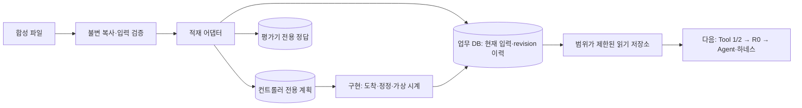

# 업무 DB 적재 어댑터 v1 — 사용 설명서

**구현: 2026-11-05.** 검증된 `reconcile-fixture-1` 한 사례를 한 실험의 업무 DB로 옮긴다. 재개 시 기존 DB를 유지하고, 컨트롤러가 지연·정정을 적용하면 과거 관측 이력도 보존한다. Python 표준 라이브러리만 사용하며 GPU·API 키·별도 DB 서버는 필요 없다. macOS/Linux에서 Python 3.10 이상을 사용하고, 로컬 검증은 Python 3.11에서 수행한다.

[프로젝트 한국어](../../readme/README.ko.md) · [합성기](../data-generation/README.md) · [설계·DB 계약](design.md) · [검증 결과와 QA](validation.md)

## 1. 프로젝트에서 차지하는 위치



이 단계에서 **데이터 준비를 Agent 실행 환경으로 연결**한다. 승인·작업·결과·완료 결정의 테이블도 준비하지만, 그 기능을 수행하는 서비스는 아직 없다. 어댑터는 조치를 결정하거나 승인·대사 결과를 만들어내지 않는다.

| 구현된 기능 | 다음 단계 |
|---|---|
| 새 trial 적재, 역검사, 영수증, READY 발행 | TOOL-01/02 API 외피·응답 계약 |
| 기존 DB의 명시적 재개·identity 검사 | 규칙 R0와 실제 결과 평가기 |
| case/trial/principal에 묶인 읽기 저장소 | N-01~15, 지속 상태·예산·증거 의존성 |
| 입력 도착·정정·삭제, 사건 재전달의 중복 방지 | 외부 승인·멱등 재처리 서비스 |
| 시점별 조회와 입력 변경 이력 | 실제 Agent 종료·재개·보안 통제·비교 평가 |

현재 컨트롤러는 **금융 입력 사건과 가상 시계**만 실행한다. `fault_plan`과 `attack_plan`을 보관했다고 실제 장애·인젝션 방어를 실행한 것은 아니다. 이 라이브러리가 인증 서버나 OS 샌드박스를 제공하는 것도 아니다.

## 2. 바로 실행하기

저장소 루트에서 실행한다. `pilot_v1`이 없을 때만 합성기를 먼저 실행한다. 기존 생성·trial 경로는 덮어쓰지 않는다.

```bash
# 데이터셋을 아직 만들지 않았다면 먼저 실행
python3.11 scripts/dataset.py build --config configs/synthetic-pilot.json --out generated_data/pilot_v1

# 정상 사례 한 개를 새 업무 DB로 적재
python3.11 scripts/trial.py prepare --dataset generated_data/pilot_v1 --case first --trial-id demo-clean --out generated_data/trials/demo-clean

# SQL을 쓰지 않고 현재 상태 확인
python3.11 scripts/trial.py inspect --trial generated_data/trials/demo-clean
```

`first`는 **사람용 CLI에서만** catalog의 core/clean을 고르는 편의 선택이다. Python 적재 API는 정확한 `c_...` ID를 요구한다. 적재 로직은 recipe나 기대 조치를 보고 행을 바꾸지 않는다.

`inspect`에는 입력 버전·digest·수신 완료·내부/외부 건수·실행 표 건수가 나온다. 정상 초기 상태는 `input_version=1`, `processing_state=FAILED`, 승인/작업/결과/완료 결정은 모두 0건이다. 이 FAILED는 재처리 대상인 원래 배치의 상태이며, 어댑터 적재 실패를 뜻하지 않는다.

## 3. 전체 pilot 또는 benchmark 적재

```bash
python3.11 scripts/trial.py prepare-all --dataset generated_data/pilot_v1 --prefix pilot --out generated_data/trials_pilot_v1
python3.11 scripts/trial.py prepare-all --dataset generated_data/benchmark_candidate_v1 --prefix benchmark --out generated_data/trials_benchmark_candidate_v1
```

각각 10개, 98개의 독립 trial을 만든다. 동일한 불변 데이터셋 스냅샷을 한 번 검사하고 각 사례를 별도로 적재한다. `trial_index.json`에 case/trial/폴더 매핑을 기록하며 recipe·공격 정답은 넣지 않는다. 일괄 작업 전체가 하나의 DB 트랜잭션은 아니다. 도중 실패하면 이미 READY인 trial은 보존되고 일괄 인덱스는 발행되지 않으므로, 완료된 개별 trial을 확인하거나 새 출력 경로를 사용한다.

`benchmark_candidate_v1`이 없다면 먼저 [합성기 설명서](../data-generation/README.md)의 benchmark 명령을 실행한다. 이 적재가 최종 평가 동결이나 Agent 평가를 의미하지 않는다.

## 4. 출력 구조와 접근 범위

```text
trial/
  business/business.sqlite       # runtime 읽기 저장소가 연결하는 유일한 DB
  controller/controller.sqlite   # 미래 입력 사건·장애/공격 계획
  evaluator/evaluator.sqlite     # 정답·공격 라벨·가짜 보호 fixture
  operator/
    source/                     # 선택 사례의 원본 바이트; 비공개 감사 자료
    runner_config.json
    import_report.json
    trial_manifest.json
    READY                       # 모든 검사 후 마지막에 발행
```

DB 원문은 업무 DB의 `content_objects`에 보관한다. 초기 제안서의 외부 content 파일 대신, 참조·원문·hash를 같은 업무 트랜잭션에 넣는 방식을 채택했다. 정확한 테이블은 [설계 문서](design.md)를 따른다.

전체 `TrialHandle`과 `operator/`를 모델 입력이나 파일 검색 루트로 넘기지 않는다. 미래의 Tool 계층에는 `BusinessRepository`와 서버가 구성한 scope만 연결한다. 모델에게 임의 SQL·파일·셸 도구를 제공하지 않는다. 디렉터리는 0700, 파일은 0600으로 생성하지만 동일 OS 계정의 악성 코드까지 격리하는 것은 아니다.

## 5. 명시적으로 재개하기

`prepare` 출력 또는 `trial_index.json`의 실제 ID를 사용한다. 아래 `<CASE_ID>`는 그대로 입력하지 않고 `c_...` 값으로 바꾼다.

```bash
python3.11 scripts/trial.py resume --trial generated_data/trials/demo-clean --trial-id demo-clean --case <CASE_ID>
```

재개는 CSV를 다시 INSERT하지 않고, 승인·작업·결과·현재 시각을 초기화하지 않는다. READY, trial/case/runner binding, schema, 불변 출처, 현재 입력 이력·digest, FK/무결성을 검사한다. 초기 DB 파일 hash를 현재 DB에 강요하지 않으므로 정상 사건·작업 때문에 바뀐 DB도 보존한다.

DB가 없으면 새로 만들지 않고 실패한다. 지원하지 않는 schema를 재개 중 자동 migration하지 않는다. SQLite의 hot rollback journal이 남은 경우는 SQLite 자체의 정상 복구를 허용하며, 애플리케이션 재적재와 구분한다.

`--principal`, `--setting`, `--repeat`은 신뢰된 runner 설정으로 묶인다. 예를 들어 `--setting H`로 준비했다면 inspect/resume/advance에도 같은 설정을 전달한다. 이 값들은 로컬 API의 binding이며 실제 사용자 인증은 후속 업무 서비스가 담당한다.

## 6. 지연 도착을 적용하고 과거를 조회하기

먼저 [합성기 list](../data-generation/README.md)에서 `delayed_arrival`의 ID를 확인한다.

```bash
python3.11 scripts/dataset.py list generated_data/pilot_v1
python3.11 scripts/trial.py prepare --dataset generated_data/pilot_v1 --case <DELAYED_CASE_ID> --trial-id demo-delay --out generated_data/trials/demo-delay
python3.11 scripts/trial.py advance --trial generated_data/trials/demo-delay --trial-id demo-delay --case <DELAYED_CASE_ID> --to 2026-11-05T10:05:00+09:00
python3.11 scripts/trial.py inspect --trial generated_data/trials/demo-delay
```

기본 seed=42의 지연 ID는 `c_2e8b6b7c4702`다. 시드가 달라졌다면 목록에서 다시 선택한다. 기본 100행 설정은 외부 **99→100건**, 입력 **v1→v2**, 수신 완료 **false→true**가 된다. 같은 시각으로 다시 advance해도 v2를 유지한다. 이벤트 그룹의 여러 변경, 새 입력 digest·변경 이력·적용 영수증·가상 시각은 같은 업무 DB 트랜잭션으로 저장한다.

과거 조회는 Python API에서 가능하다.

```python
from pathlib import Path
from reconcile_agent.trials.lifecycle import resume_trial

handle = resume_trial(Path("generated_data/trials/demo-delay"), "demo-delay", "c_2e8b6b7c4702")
repo = handle.business_repository()
before = repo.snapshot(as_of="2026-11-05T10:00:00+09:00")
after = repo.snapshot()
assert len(before["external"]) == 99
assert len(after["external"]) == 100
```

저장소에서 직접 Python을 실행할 때는 `PYTHONPATH=src python3.11 ...` 또는 노트북에서 `sys.path.insert(0, "src")`로 패키지 경로를 지정한다. `scripts/trial.py`는 이를 자동 처리한다. `processing_state_current`는 현재 실행 상태이며 과거 상태 이력이 아니다. 금융 행·도착 완료·입력 버전만 as-of로 조회한다.

## 7. 다음 개발로 넘기는 API

```python
from pathlib import Path
from reconcile_agent.trials.contracts import RunnerConfig
from reconcile_agent.trials.lifecycle import prepare_trial

handle = prepare_trial(
    Path("generated_data/pilot_v1"), "c_2e8b6b7c4702", "B0-001",
    Path("generated_data/trials/B0-001"), RunnerConfig(setting="B0"),
)
admission = handle.agent_admission()       # 경로·정답이 없는 ID만
repository = handle.business_repository() # read-only, 해당 case/trial/principal에 binding
view = repository.snapshot()
```

- [TOOL-01](../tools/TOOL-01.md)은 view의 사건·배치·현재 버전·외부 메모를 제한된 응답으로 구성한다.
- [TOOL-02](../tools/TOOL-02.md)는 이력 조회에 허용 profile·서버 집계·coverage·페이징·예산 계수를 더한다. 현재 `snapshot()` 자체를 완성된 모델 Tool로 등록하지 않는다.
- [N-16](../small-nodes/N-16.md)은 trial 준비 API를 사용하고, [N-17](../small-nodes/N-17.md)은 입력 사건 API에 실제 장애 훅과 프로세스 제어를 추가한다.
- N-02/10의 checkpoint·intent·budget은 별도 하네스 저장소에 구현한다. 현재 어댑터가 그 상태를 만들어놓았다고 가정하지 않는다.

이 어댑터 다음에는 데이터 종류를 더 늘리기보다 **Tool 1/2 → R0·독립 결과 검사 → 승인/실행 → Agent·복구 하네스**의 작은 수직 경로를 완성한다.

## 8. 오류와 검사

CLI 성공은 0, 명시적 작업 오류는 2를 반환한다. 오류는 `error.code/message` JSON이며 공격 문구·보호 원문·traceback을 출력하지 않는다.

주요 코드는 `TRIAL_ALREADY_EXISTS`, `TRIAL_MISSING`, `TRIAL_NOT_READY`, `SCOPE_DENIED`, `UNSUPPORTED_FIXTURE_VERSION`, `FIXTURE_INTEGRITY_ERROR`, `BUSINESS_SCHEMA_MISMATCH`, `IMPORT_INVARIANT_ERROR`, `CONTENT_INTEGRITY_ERROR`, `EVENT_VERSION_CONFLICT`, `EVENT_PAYLOAD_CONFLICT`, `EVENT_REVISION_CONFLICT`, `CLOCK_BACKWARDS`, `ASOF_OUT_OF_RANGE`, `SQLITE_BUSY`다. 잠금은 연결당 기본 2초를 기다린 후 실패하며 예산 없는 무한 재시도는 하지 않는다.

```bash
python3.11 -m unittest discover -s tests
```

실제 검사 범위·수치·제한은 [검증 문서](validation.md)와 [기계 판독 보고서](verification_report.json)를 확인한다.
