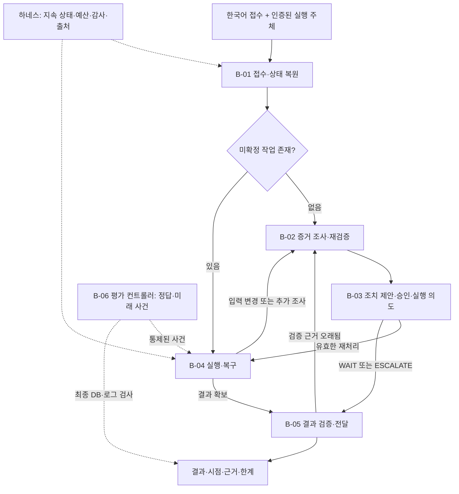

# 전체 구조와 실행 경로

> 상태: 목표 구조 설계. [Overall Plan](README.md) · [노드 지도](node-map.md) · [명명·상태 계약](../contracts/state-and-types.md)

## 1. 계층과 권한

B-01~B-05의 분기는 사전 정의한다. 모델은 제한된 질의 계획과 조치 제안을 만들고 코드는 이를 승인·실행 가능 상태로 변환한다. 모델이 그래프·권한·승인을 새로 만들 수는 없다. B-06은 모델의 라우팅 대상이 아니다.

## 2. 정상 실행 예시

`N-01 → N-02 → N-03 → N-04 → N-05 → N-06 → N-07 → N-08 → N-09 → N-10 → N-11 → N-13 → N-14 → N-15`

N-09는 승인 요청과 대기를 관리한다. 승인을 실제로 발급하는 주체는 별도 사람 UI 또는 평가용 결정적 승인 시뮬레이터다. 거부·만료·입력 변경이면 실행으로 진행하지 않는다.

N-08이 WAIT/ESCALATE를 제안한 경우 N-09~N-13의 쓰기 경로를 생략하고 B-05에서 해당 판단의 근거를 검사한다. N-15는 새로운 결론을 만들지 않고 확정된 결과를 전달한다.

## 3. 중단 후 경로

체크포인트에서 미확정 `operation_id`와 `idempotency_key`가 확인되면 `N-03 → N-12`로 진입한다. N-12는 TOOL-05를 통해 반영 여부를 확인한다.

- SUCCEEDED: 결과 참조를 회수하고 N-13으로 이동.
- NOT_APPLIED가 권위 있게 확인되고 같은 작업 재시도가 허용됨: 현재 입력을 재확인하기 위해 B-02로 이동. 같은 의도의 재시도만 같은 키 사용.
- RUNNING/UNKNOWN: 한도 내 조회. 정보가 부족하면 이관.
- 입력 변경: 과거 효과와 현재 입력을 두 축으로 기록하고 B-02에서 새 계획·승인을 준비. 적용된 과거 작업을 미반영으로 바꾸지 않음.

구체적인 조건부 엣지는 각 [Big Node](../big-nodes/README.md)가 소유한다. Small Node는 다음 함수를 직접 실행하지 않는다.

## 4. 데이터 저장소의 분리

| 저장소 | 보관 | 접근 주체 |
|---|---|---|
| 업무 DB | 입력 이력·배치·승인·작업·결과·완료 증명 | 제한된 업무 Tool 및 내부 서비스 |
| Agent 상태 DB | 체크포인트·의도·관측·사용 예산·종료 기록 | 하네스 |
| 평가 저장소 | 정답·미래 이벤트·장애·공격 계획·독립 검사 결과 | B-06 전용 |
| 아티팩트 | 공개 가능한 요약·실행 기록·원시 평가 출력 | 역할에 맞춘 경로·권한 |

업무 DB와 체크포인트 간 분산 트랜잭션은 가정하지 않는다. 둘이 어긋나는 것을 정상적인 복구 문제로 다룬다. 업무 DB의 승인·멱등성 검사는 R0/B0/B1/H 모두 공통이다.

## 5. Tool과 노드

같은 Tool 구현을 B0의 도구 루프와 H의 고정 그래프가 공유한다. H는 호출 시점과 허용 분기를 더 엄격히 관리하지만 기준선에만 데이터·조회 능력을 숨기지 않는다. 모델 호출은 주로 N-04/N-08에 국한하고 N-15는 결정적 템플릿을 기본으로 한다.

모델 버전·프롬프트·양자화·파서·디코딩과 코드 버전, 기본 예산을 함께 기록한다. 상세 계약은 [상태](../contracts/state-and-types.md), [복구](../contracts/persistence-and-recovery.md), [보안](../contracts/security-boundary.md)을 따른다.
